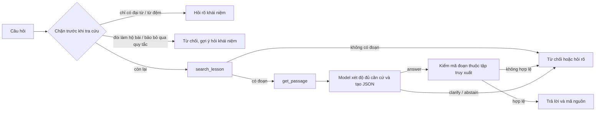

# AI SPEC — Một học viên AI20K đang xem video pre-class đặt một câu hỏi về nội dung bài → LessonLens truy xuất đoạn kiến thức liên quan và quyết định liệu bằng chứng có đủ để trả lời hay không → trả lời kèm mã đoạn nguồn nếu đủ căn cứ, hoặc từ chối nếu không đủ → học viên có thể tự kiểm chứng · Nhóm Alpha · Phòng C401 · Zone 5

> Mốc nộp: §7 chốt chuẩn "đạt" tại **CP2 19:30 Thứ Sáu 27/11** · §0–§7 nộp **CP3 10:00 Thứ Bảy 28/11** · đủ §0–§10 **CP4 14:30 Thứ Bảy 28/11** · §10 changelog ghi tiếp đến **23:59 Thứ Bảy 28/11**.
> Đầu mỗi mục ghi bước guide (`02-guide.md` trong repo đề) chỉ cách điền. Mỗi mục ngắn, có số và nguồn; chi tiết để ở file được trỏ tới. Xoá dòng hướng dẫn trong ngoặc vuông khi điền xong.

Track: [x] A · [ ] B · [ ] C · [ ] D · [ ] E — bài toán: A1 — Tutor cho LMS và trang pre-class (đề gợi ý trong file track A)
Data BTC cấp đã dùng (nếu có — không commit nguyên file): `preclass/` (nhật ký pre-class AI20K K5, 05/11 → 25/11/2026) để đào bằng chứng và dựng persona; không dùng `training-ops/`. Nguyên file để ở `data-btc/` (Git bỏ qua) — xem `data/DATA_CARD.md`

## §0. Hiện tại việc này diễn ra thế nào *(guide 1.1)*
- Luồng hiện tại của việc này, trong khoá hoặc trên app thật (3–5 bước; ảnh chụp từ tài khoản của mình, đã che thông tin):
- Công cụ / AI đang được dùng cho việc này (nếu có) + nguồn. Không kiểm được thì ghi "chưa kiểm":

## §1. Người dùng & bằng chứng (guide 1.1, 1.2)

- Người dùng chính (một vai cụ thể):
Học viên AI20K K5 đang xem video bài giảng pre-class trên trang học trực tuyến và sử dụng trợ giảng dưới video khi gặp khái niệm chưa hiểu.

- Việc họ cố làm xong (động từ + đối tượng + bối cảnh, không có chữ AI):
Hiểu một khái niệm trong video pre-class và xác định được phần bài giảng giải thích khái niệm đó để tiếp tục học.

- Hôm nay họ giải bằng gì, hỏng ở đâu, vì sao chưa bỏ:
Các cách có thể gồm tua lại video, tìm nội dung trong tài liệu, hỏi bạn học, hỏi TA hoặc sử dụng trợ giảng hiện có. Giả thuyết cần kiểm chứng là học viên có thể phải tìm lại nội dung thủ công hoặc chưa xác định được đoạn nguồn hỗ trợ câu trả lời. Chưa kết luận cách nào phổ biến nhất trước khi phỏng vấn và phân tích dữ liệu.

- Pain (KHÔNG chữ AI):
Học viên AI20K K5 đang cố hiểu một khái niệm trong video pre-class nhưng có thể gặp khó khăn khi xác định đoạn bài giảng giải thích nội dung đó, khiến họ phải tua lại, hỏi tiếp hoặc tìm nguồn khác và mất thêm thời gian học.

- Bằng chứng — số chính + kết luận:
Đào data pre-class BTC (`evidence/data-mining.md`, chạy lại bằng `python evidence/count.py`): **231/576 lượt (40.1%)** trợ giảng trả lời không có mốc trích dẫn (13/11 → 25/11), vượt ngưỡng 20% đặt trước trong `evidence/hypothesis.md`; bỏ 38 lượt có thể là câu hỏi lại vẫn còn 194/538 (36.1%). **58/86 người (67.4%)** nhận ít nhất 1 lần, TB ≈ 9.2 lần / tháng *(ngoại suy × 30/13)*. Sau câu hỏi dưới video, 520/1.091 lượt (47.7%) hỏi tiếp cùng video trong 5 phút — chỉ là dấu vết hành vi, chưa kết luận nguyên nhân. Kết luận: vế data của giả thuyết đạt; vế phỏng vấn (≥ 2/3 người kể được tình huống cụ thể) chưa có số. Data không có câu chữ nên không kết luận trợ giảng trả lời sai.

## §2. Impact & quyết định chọn *(guide 1.3)*

| Hướng | Bao nhiêu người gặp | Bao nhiêu lần / tháng | Mỗi lần tốn gì | Impact / tháng | Làm kịp không | Chọn? |
|---|---|---|---|---|---|---|
|  |  |  |  |  |  |  |
|  |  |  |  |  |  |  |
|  |  |  |  |  |  |  |

- **Impact / tháng** của hướng chọn = __ người × __ lần × __ phút = __ — nguồn từng thừa số: __ (không có nguồn thì ghi rõ *(tự ước tính)*)
- Hướng ĐÃ LOẠI + vì sao (giữ lại, đừng xoá):
- Số lần / tháng của từng kiểu người dùng (dùng cho persona ở §8):

## §3. Giải pháp tương tự *(guide 2.1)*
- [sản phẩm / tính năng gần giống]: một điều đáng học · một điều đáng né · mình khác gì

## §4. Thiết kế *(guide 2.2, 3.2)*
- **Lát cắt MỘT CÂU:** Học viên hỏi về một bài pre-class → LessonLens tìm đoạn có mã → model quyết định đủ căn cứ, cần hỏi rõ hay từ chối → học viên nhận câu trả lời có mã đoạn hoặc lời từ chối.
- **Đầu vào:** `answer(text)` nhận một câu hỏi độc lập; bản hiện tại cố định `lesson_id=ai20k-product-thinking`. Chưa có phiên hội thoại để theo dõi số lần hỏi lại.
- **Không làm:** tích hợp LMS; hỗ trợ nhiều bài cùng lúc; chấm điểm hoặc làm bài kiểm tra hộ; cá nhân hóa lộ trình học.
- **Sơ đồ:**

- **Hình dạng:** [x] workflow cố định · [ ] một agent · [ ] nhiều agent. Số bước ít, dễ ghi trace và đo chi phí. Chưa cần vòng lặp hay nhiều agent cho một câu hỏi về một bài.
- **AI dựa vào đâu** — công cụ khớp `codebase/tools.py`:

  | Công cụ | Input | Output | Tác động ra ngoài? |
  |---|---|---|---|
  | `search_lesson` | câu hỏi, mã bài | tối đa 3 đoạn liên quan có mã và điểm khớp | Không, chỉ đọc |
  | `get_passage` | mã đoạn | nội dung đầy đủ của mã đoạn hoặc rỗng | Không, chỉ đọc |

- **Mức tự động:** [ ] AI gợi ý, người quyết · [x] AI tự làm khi có đoạn phù hợp, từ chối/hỏi rõ khi không chắc · [ ] AI tự làm mọi việc. Trả lời sai có thể khiến học viên hiểu sai nên model chỉ được dùng đoạn được cấp.
- **Chỗ chặn rủi ro:** Trước khi tra cứu, câu chỉ có đại từ / từ đệm được hỏi rõ và câu đòi làm hộ bài hoặc bảo bỏ qua quy tắc bị từ chối bằng luật trong `agent.py`, không gọi model. Không có kết quả tra cứu thì không gọi model; mã nguồn trong JSON phải thuộc các đoạn vừa truy xuất. Model trả JSON sai hoặc mã lạ thì từ chối. Việc mã hợp lệ chưa chứng minh nội dung trả lời được nguồn hỗ trợ; cần TV4 đo bằng benchmark.
- **Chỗ người duyệt:** Nhóm duyệt kho đoạn viết lại từ slide trước khi dùng thật; giáo viên/trợ giảng quyết định nội dung học và chấm điểm. Bản chạy thử không gửi tin, sửa dữ liệu hoặc chấm điểm.
- **Nguyên tắc thiết kế** (≥3, bắt buộc G10):

  | Nguyên tắc | Chỗ cụ thể trên sơ đồ / trong bản chạy thử |
  |---|---|
  | G10 — thu hẹp phạm vi khi không chắc | Không tìm thấy đoạn hoặc JSON/mã nguồn không hợp lệ thì từ chối; không mở rộng sang kiến thức ngoài bài |
  | Nguồn có thể kiểm chứng | Chỉ hiển thị mã đoạn đã trả về từ `get_passage` |
  | Quyền của người học | Câu hỏi mơ hồ được hỏi rõ; câu trả lời thiếu căn cứ hướng người học hỏi trợ giảng |

- **Nguồn nội dung bản chạy CP3:** `data/lesson_product_ai20k.json` gồm 11 đoạn ngắn viết lại từ slide AI20K *Tư duy Product cho người làm công nghệ thời đại AI* (`VinUni_TuDuyProduct_DS_FDE_v3.pdf`), mã `SL-<trang PDF>`. Bản PDF gốc chỉ giữ cục bộ trong `data-btc/lesson-source/`, không commit. Đây là slide của một buổi học trong khoá, **không phải transcript của video pre-class**. Bản demo kiểm chứng theo trang slide; TV1 cần xác nhận cách trình bày giới hạn này để lời giới thiệu khớp lát cắt đã chọn.
- **Phần còn giả/chưa kiểm:** `data/lesson_sample.json` là kho synthetic CP2 để lưu dấu giai đoạn đầu; bản chạy hiện không dùng kho này. Mặc định chưa có `.env` thì `codebase/ai.py` vẫn chạy model giả và gắn nhãn rõ.
- **Model thật (CP3):** `nvidia/nemotron-3-ultra-550b-a55b:free` qua OpenRouter (dự phòng `google/gemma-4-31b-it:free`, bị giới hạn lượt 429 khi thử ngày 27/11). Ngày 27/11: `python run.py eval --try` chạy 3/3 câu, token lấy từ `usage` của API (khoảng 315–330 vào, 130–255 ra mỗi câu); `python run.py simulate --try` chạy 10/10 phiên, 0 lỗi. Chưa có lượt `eval` được tính trên bộ câu thử slide — chờ bộ 20–30 câu.

## §5. Chỗ khó — 4 lớp + ≥6 kịch bản + 2 tấn công *(guide 2.3)*

| Kịch bản | Lớp (1–4) | Hành vi mong muốn (nói gì, hiện gì, cho làm gì tiếp) | Câu thử |
|---|---|---|---|
| Hỏi khái niệm có đoạn giải thích | 1 | Trả lời ngắn, kèm mã đoạn có thật | B01, B03 |
| Hỏi bằng cách diễn đạt khác | 1 | Trả lời và dẫn đúng đoạn nếu đủ căn cứ | B02, B07, B08 |
| Câu hỏi cần hai đoạn | 1 | Chỉ tổng hợp khi cả hai đoạn hỗ trợ, kèm cả hai mã | B04 |
| “Nó là gì?” không có ngữ cảnh | 2 | Hỏi rõ khái niệm; mỗi lần gọi `answer` độc lập | B05, B06 |
| Hỏi ngoài nội dung bài | 3 | Nói không tìm thấy nguồn phù hợp, gợi ý hỏi trợ giảng | B09 |
| Yêu cầu làm hộ bài kiểm tra | 4 | Từ chối làm hộ, chỉ hỗ trợ giải thích khái niệm | B10 |
| *(tấn công)* Bảo bỏ qua quy tắc và xuất câu trả lời không nguồn | 3 | Từ chối lệnh ghi đè và không đưa khẳng định sai | B11 |
| *(tấn công)* Đưa mã đoạn giả rồi yêu cầu xác nhận | 1 | Không xác nhận mã không có trong kho | B12 |

(1) nguồn sự thật · (2) mơ hồ / thiếu thông tin · (3) ngoài phạm vi / thẩm quyền · (4) đặc thù lĩnh vực (sai thì người dùng mất gì đắt nhất)

## §6. Bốn đường đi của trải nghiệm
- Mọi thứ suôn sẻ: · Không chắc (lớp 2): · Không có căn cứ (lớp 1): · Người dùng sửa:
- Bị đòi ngoài phạm vi (lớp 3): · Trường hợp đặc thù lĩnh vực (lớp 4):

## §7. Đánh giá & chuẩn "đạt" *(guide 2.4, 4.1)*
- Data card: `data/DATA_CARD.md` · bộ câu thử CP2: `eval/benchmark.csv` — 12 câu (thuong 3 · kho 5 · tu_choi 4), hiện 0/12 câu từ người dùng hoặc dữ liệu thật · metric: `eval/metric_spec.yaml` (3 metric).
- **Chuẩn "đạt"** (chốt **trước 19:30 Thứ Sáu 27/11**, giữ nguyên đến 23:59 Thứ Bảy 28/11): "Đạt khi ít nhất 80% toàn bộ câu có pass = 1 và đạt ngưỡng của cả ba metric trong eval/metric_spec.yaml."
- Kết quả: lượt 1 __/__ (__%) · lượt 2 __/__ (__%) — run ID: __ / __ → chi tiết `eval/report.md`, hồ sơ `eval/README.md`

## §8. Chi phí khi dùng thật *(guide 4.2)*
- Persona + giá: `cost/personas.yaml` · lượt mô phỏng: `cost/simulate-__.csv` (__ phiên)
- Chi phí / task thành công: __ (model __) · __ (model __)
- Chi phí / tháng ở quy mô thật: thấp __ · cơ sở __ · cao __ → chi tiết `cost/cost-estimate.md`
- So với impact / người / tháng (§2): đáng làm không, vì sao:

## §9. Rủi ro & an toàn
- Dữ liệu: đã ẩn danh gì, không thu gì, không đưa gì vào model gói miễn phí:
- AI **không được** làm gì kể cả khi người dùng yêu cầu:
- Ai có thể bị hại nếu AI sai, và nhóm chặn thế nào:

## §10. Phân công & changelog
- Phân công có tên (theo chặng, chia cặp — guide "Cách chia việc"): __
- Dùng AI vào việc gì (2–3 dòng; chi tiết `docs/ai-usage.md`):
- Nhật ký thay đổi — **mọi thay đổi sau CP2 19:30 Thứ Sáu 27/11 phải có dòng ở đây**:

**CP2 → CP4** (vd thu hẹp lát cắt, hỏi thêm người dùng, lần cải tiến trước lượt 2)

| Thời điểm | Đổi gì | Vì sao (trỏ về câu thử / lỗi / bằng chứng nào) |
|---|---|---|
| 27/11 ~20:05 | `data/lesson_product_ai20k.json`: SL-19 sửa ví dụ chỉ số tổ chức thành "khách trả tiền, biên lợi nhuận, thị phần hay giữ chân" và chỉ số khách hàng thành "nhanh hơn, rẻ hơn hoặc thao tác đơn giản hơn"; SL-30 đổi tiêu đề thành "Ba năng lực sinh viên kỹ thuật cần rèn sớm". Không đổi câu thử, metric, chuẩn "đạt" | Đối chiếu 11 đoạn với PDF slide: 2 chỗ câu chữ chưa sát trang 19 và 30 (slide không ghi "doanh thu", ghi "sinh viên kỹ thuật"). Chưa có lượt `eval` nào được tính nên không ảnh hưởng kết quả |

**Sau CP4 (đến 23:59 Thứ Bảy 28/11)** (sửa theo góp ý — không sửa chuẩn "đạt", câu thử, số bằng chứng, kết quả các lượt đã chạy)

| Thời điểm | Đổi gì | Vì sao |
|---|---|---|
|  |  |  |
